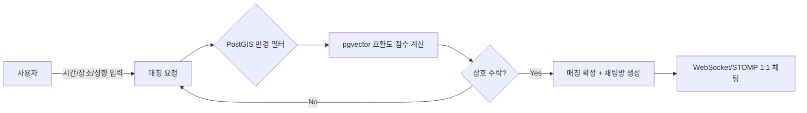
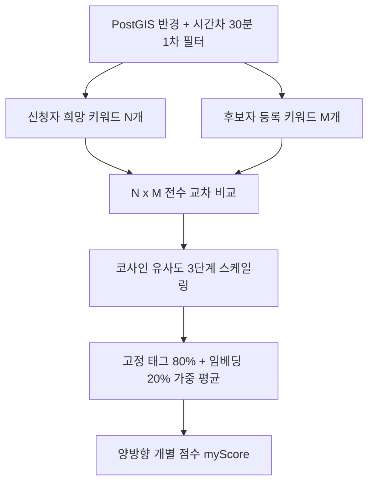
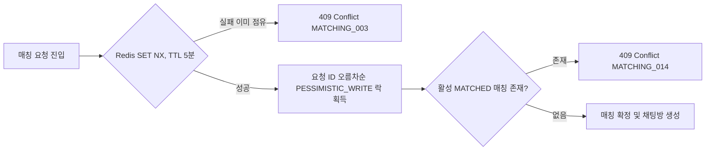

# 마주한끼 (Maju-Hankki) — 식사 동반자 매칭 서비스

> 부트캠프 2차 프로젝트 (2인 팀) · 혼자 밥 먹기 싫은 순간, 근처에서 같은 시간에 밥 먹을 사람을 실시간으로 매칭해주는 서비스

이 저장소는 팀 레포(fork)를 기반으로, 본인(sangmin)이 담당한 백엔드 개발 전반을 중심으로 정리한 포트폴리오용 README입니다. 실제 커밋 이력과 코드, docs/troubleshooting 문서를 근거로 작성했습니다.

## 한눈에 보기

| 항목 | 내용 |
| --- | --- |
| 서비스 | 식사 동반자 실시간 매칭 (시간·장소·음식 성향 기반) |
| 팀 구성 | 2인 (부트캠프 2차 프로젝트) |
| 담당 역할 | 백엔드 개발 전반 |
| 차별점 | 자유 텍스트 식사 성향을 임베딩으로 변환해 호환도까지 점수화 |
| 대표 트러블슈팅 | 리프레시 토큰 쿠키 중복 발급, 실시간 매칭 동시성 붕괴 |



## 담당 역할 (sangmin — 백엔드 개발 전반)

| 영역 | 작업 내용 |
| --- | --- |
| 인증/인가 | Spring Security + JWT 구조 설계·구현 |
| 소셜 로그인 | Google OAuth2 연동 |
| 실시간 채팅 | WebSocket/STOMP 기반 1:1 채팅 |
| 지도 연동 | 카카오맵 선호 지역 등록/표시, 행정동 좌표 서버 재검증 |
| 매칭 도메인 | Redis 대기열, PostGIS 거리 필터, 비관적 락 기반 동시성 제어 |
| 매칭 점수 | pgvector 단어 단위 임베딩 교차 비교로 호환도 산출 로직 고도화 |
| 트러블슈팅 | 리프레시 토큰 쿠키 중복 발급, 실시간 매칭 동시성 이슈 해결 |

## 기술 스택


## 핵심 구현 내용

### 1. Spring Security + JWT 인증 구조

| 구성요소 | 역할 |
| --- | --- |
| `JwtProvider` | 사용자 UUID·역할(UserRole)을 클레임에 담아 HS256 서명 Access Token 발급, issuer/audience 검증 |
| `JwtFilter` | 매 요청 토큰 검증 후 SecurityContext에 인증 정보 세팅 |
| `RefreshTokenRepository` + `RefreshTokenHasher` | Refresh Token을 해시로 DB 저장, `OpaqueTokenGenerator`로 발급해 Access Token과 분리 관리 |
| RTR(Refresh Token Rotation) | 재발급마다 토큰 교체, 재사용 감지(`RefreshTokenReuseDetectedException`) 시 세션 계열 전체 폐기 |
| `DelegatingPasswordEncoder` | bcrypt/argon2 선택적 적용 |
| CSRF | `CookieCsrfTokenRepository` + `SpaCsrfTokenRequestHandler`로 SPA에 맞게 처리 |

### 2. Google OAuth2 소셜 로그인

| 처리 흐름 | 내용 |
| --- | --- |
| 회원 조회 | `GoogleOAuthUserService`에서 Google `providerId`/이메일로 기존 회원 조회, 없으면 신규 가입 |
| 중복 가입 방지 | 동일 이메일로 다른 로그인 방식(LOCAL/KAKAO 등) 가입돼 있으면 차단 (`AUTH_005`) |
| 닉네임 충돌 처리 | 비어있거나 중복되면 `사용자_xxxxxxxx` 형태로 안전 생성 |
| 비활성 계정 차단 | 탈퇴 등으로 비활성화된 계정은 로그인 시점에 차단 (`AUTH_001`) |

### 3. WebSocket/STOMP 기반 실시간 채팅

| 구성요소 | 역할 |
| --- | --- |
| `WebSocketConfig` | `/ws-chat` STOMP 엔드포인트 등록 |
| `WebSocketHandshakeInterceptor` | 핸드셰이크 단계 쿠키 기반 JWT 인증 |
| `ChatSubscriptionInterceptor`(인바운드) / `ChatOutboundAccessInterceptor`(아웃바운드) | CONNECT/SUBSCRIBE/SEND 시점마다 채팅방 접근 권한 검증 |
| 악용 방지 | 메시지 크기 16KB 제한, 전송 버퍼/타임아웃 제한, `ChatMessageRateLimiter`로 전송 속도 제한 |
| 영속화 | `ChatMessage`, `ChatRoom` 엔티티 |

### 4. 카카오맵 기반 선호 지역 등록/표시

| 구성요소 | 역할 |
| --- | --- |
| 프론트엔드 (`match-map.js`) | 카카오맵으로 선호 지역 지도 표시/선택 |
| `KakaoRegionPinValidator` | 카카오 로컬 API(`/v2/local/geo/coord2regioncode.json`)로 좌표가 실제 행정동(H)/법정동(B) 코드 안에 있는지 서버 측 재검증 |
| 장애 대응 | API 키 미설정·호출 실패 시 `UNAVAILABLE`로 분류해 품질 저하 없이 우회 |

### 5. pgvector 임베딩 기반 매칭 호환도 점수 계산

가장 공을 들인 부분입니다. 단순 태그 매칭만으로는 어떤 음식을, 어떤 분위기로 먹고 싶은지처럼 사용자가 자유 텍스트로 적는 미묘한 취향 차이를 반영할 수 없어서, 텍스트 임베딩 기반 의미 유사도를 도입했습니다.



| 설계 포인트 | 내용 |
| --- | --- |
| 데이터 모델 | `UserPersonalityEmbedding`을 1사용자-N단어(원자 레코드) 구조로 리팩터링(1NF 정규화). 단어 1개당 1536차원 벡터 1개를 독립 레코드로 저장 |
| 벡터 저장 | `@JdbcTypeCode(SqlTypes.VECTOR)` + `columnDefinition = "vector(1536)"`로 `float[]`를 PostgreSQL `vector(1536)` 컬럼에 직접 바인딩 (hibernate-vector), 임베딩 생성은 Spring AI(`spring-ai-starter-model-google-genai-embedding`) |
| 비교 방식 | `PersonalityCompatibilityCalculator.calculateFullMatrixCrossScore`로 N×M 전수 교차 비교 — 각 신청자 단어마다 가장 유사한 후보 단어 점수를 구해 평균 |
| 0점 처리 | 일치 태그 0개일 때 과거 50점(중립) 기본값을 버리고 0점으로 명확히 계산, 애매한 고점수 방지 |
| 최종 점수 | 고정 태그(80%) + 임베딩 유사도(20%) 가중 평균, 한쪽 신호만 있어도 있는 신호로 산출 |
| 양방향 점수 | `myScore` — 두 사용자 점수 중 낮은 쪽(pairScore) 대표값 방식을 버리고, 내가 상대를 원하는 정도/상대가 나를 원하는 정도를 각각 독립 계산 |
| 사전 필터 | `BidirectionalCandidateSearchService`가 PostGIS 공간 쿼리로 반경·시간차 30분 이내 후보를 1차로 좁힌 뒤에만 호환도 계산 수행 |

```java
@JdbcTypeCode(SqlTypes.VECTOR)
@Column(nullable = false, columnDefinition = "vector(1536)")
private float[] embedding;
```

**코사인 유사도 3단계 스케일링** — 단순 코사인 유사도(-1~1)를 그대로 쓰면 실제 임베딩 공간에서 값이 좁은 범위(대략 0~0.5)에 몰려 변별력이 떨어지는 문제가 있어, 구간별로 다른 기울기를 적용했다.

| 코사인 유사도 구간 | 점수 구간 | 의미 |
| --- | --- | --- |
| 0 ~ 0.20 | 0 ~ 30점 | 거의 무관한 단어 |
| 0.20 ~ 0.50 | 30 ~ 70점 | 느슨하게 관련 |
| 0.50 ~ 1.0 | 70 ~ 100점 | 의미적으로 가까운 단어 |

## 트러블슈팅

### 1. Refresh Token 쿠키 중복 발급 및 세션 꼬임

| 구분 | 내용 |
| --- | --- |
| 증상 | 로그인/재발급 시 동일 이름(`refreshToken`) 쿠키가 2개 생성 → 요청마다 두 값이 함께 전송 → 토큰 회전(RTR) 중 어떤 쿠키가 유효한지 불명확해져 정상 세션이 강제 폐기되거나 401 반복 |
| 원인 | 초기 쿠키 경로가 `Path=/auth`였다가 `Path=/`로 변경됨. 브라우저는 쿠키를 이름+경로 조합으로 식별해 새 쿠키가 기존 쿠키를 덮어쓰지 않고 공존 → `/auth` 하위 요청 시 두 경로 모두 매칭되어 쿠키 2개 동시 전송 |
| 해결 1 | `AuthCookieUtil.deleteLegacyRefreshTokenCookie()` 추가 — 토큰 발급/재발급/로그아웃 시 `Path=/auth, Max-Age=0` 쿠키를 함께 내려 구버전 쿠키를 명시적으로 만료 |
| 해결 2 | `AuthController`에서 요청에 담긴 모든 `refreshToken` 쿠키를 스트림으로 수집 후 `distinct()`로 중복 제거 → 레거시 DB 세션까지 안전하게 일괄 폐기 |

### 2. 실시간 매칭 중복 요청 및 동시성 이슈

| 구분 | 내용 |
| --- | --- |
| 증상 | 매칭 요청 버튼 연타·다중 탭/디바이스 동시 요청 시 중복 대기 요청 생성, 심하면 한 사용자가 동시에 2개 이상의 `MATCHED` 매칭/채팅방에 매핑되는 데이터 정합성 붕괴 |
| 원인 1 | 기존 검사 로직이 `WAITING` 상태 요청 존재 여부를 단순 SELECT로만 확인 → 두 요청이 거의 동시에 들어오면 둘 다 "기존 요청 없음"으로 판정되어 중복 저장 |
| 원인 2 | Redis 기반 지리 대기열 탐색과 PostgreSQL 제안/매칭 저장 사이의 비동기 시차 → 두 후보가 동일 유저를 동시에 상호 수락하면 원자적 잠금 없이 Match/ChatRoom 중복 생성 가능 |

해결:



- Redis 분산 락: 매칭 요청/제안 수락 진입 시 match:user:{userId} 키를 SET NX(TTL 5분)로 원자적 예약해 동일 사용자의 중복 진입을 차단.
- DB 비관적 락: 상호 수락 확정 트랜잭션에서 두 MatchRequest의 ID를 오름차순으로 정렬해 PESSIMISTIC_WRITE 락을 걸어, 교착 상태 없이 경쟁 상황에서 한쪽만 성공하도록 처리.
- 사용자당 활성 매칭 1개 정책: 새 요청 생성 전 Match.status = MATCHED인 활성 매칭 존재 여부를 선조회해 중복 매칭 자체를 서비스/DB 레벨에서 차단.

## 모니터링

monitoring/ 아래 Prometheus + Grafana 구성이 포함되어 있고, 대시보드(project2-overview.json)에는 HTTP 요청량/응답시간, JVM 메모리, HikariCP 커넥션 수, CPU 사용률 외에 매칭 후보 제안 처리량, 매칭 처리 시간(p95), 선택 기간 최종 매칭 완료 수 등 매칭 도메인 전용 지표 패널을 포함해 서비스 핵심 지표를 직접 추적할 수 있도록 구성했습니다.

## 실행 방법

```bash
# 1. 인프라 (Redis / Prometheus / Grafana) 기동
docker compose up -d

# 2. 백엔드 (Spring Boot)
./gradlew bootRun

# 3. 프론트엔드
cd frontend
npm install
npm run dev
```

PostgreSQL은 pgvector, PostGIS(hibernate-spatial) 확장이 활성화되어 있어야 하며, Google OAuth2 / Kakao REST API 키 등은 환경 변수 또는 application.yml 설정이 필요합니다.
