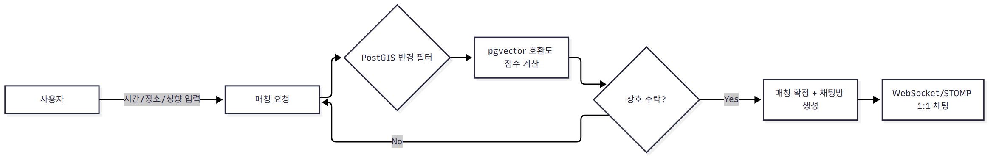
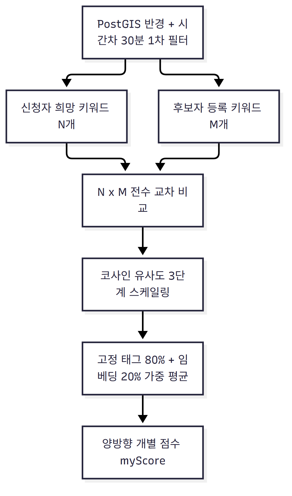

# 마주한끼 (Maju-Hankki) — 식사 동반자 매칭 서비스

> 부트캠프 2차 프로젝트 (2인 팀) · 혼자 밥 먹기 싫은 순간, 근처에서 같은 시간에 밥 먹을 사람을 실시간으로 매칭해주는 서비스

이 저장소는 팀 레포(fork)를 기반으로, 본인(sangmin)이 담당한 백엔드 개발 전반을 중심으로 정리한 포트폴리오용 README입니다. 실제 커밋 이력과 코드, docs/troubleshooting 문서를 근거로 작성했습니다.

## 한눈에 보기

| 항목 | 내용 |
| --- | --- |
| 서비스 | 식사 동반자 실시간 매칭 (시간·장소·음식 성향 기반) |
| 팀 구성 | 2인 (부트캠프 2차 프로젝트) |
| 담당 역할 | 백엔드 개발 전반 |
| 차별점 | 자유 텍스트 식사 성향을 임베딩으로 변환해 호환도까지 점수화 |



## 담당 역할 (sangmin — 백엔드 개발 전반)

| 영역 | 작업 내용 |
| --- | --- |
| 인증/인가 | 초기 Security/JWT 스캐폴딩 작성, 토큰 재발급(`/auth/token/refresh`) API 구현, 로그아웃 쿠키 버그 수정 |
| 소셜 로그인 | Google OAuth2 연동 |
| 실시간 채팅 | WebSocket/STOMP 기반 1:1 채팅 |
| 지도 연동 | 선호 지역(시/군/구) 조회 API, 카카오맵 마커 UI 개선 |
| AI 키워드 추출 | LLM 기반 희망 키워드 추출 API + fallback 로직, 비동기 임베딩 생성 이벤트 핸들러 |
| 매칭 점수 | pgvector 단어 단위 임베딩 교차 비교로 호환도 산출 로직 리팩터링(1NF 데이터 모델, N×M 비교, myScore 분리) |

## 기술 스택


> Redis 기반 실시간 매칭 대기열, Prometheus/Grafana 모니터링, Docker 인프라는 팀원이
> 구축한 영역이라 이 README의 "기술 스택"에서는 본인이 직접 다룬 것만 남겼다
> (PostGIS는 `Region` 엔티티의 좌표 컬럼에 한해 직접 사용했다).

## 핵심 구현 내용

### 1. 인증 — 초기 스캐폴딩과 토큰 재발급 API

초기 Security/JWT 기본 골격(`JwtProvider`, `JwtFilter`, `SecurityConfig`, `AuthCookieUtil` 등)을
처음 작성한 것은 본인이지만, 그 다음 날 팀원이 Google OAuth2와 Opaque Refresh Token
Rotation(RTR) 구조로 크게 리팩터링했다. 즉 **현재 RTR 메커니즘 자체(토큰 해시 저장,
재사용 탐지, 토큰 회전 로직)는 팀원이 설계·구현**한 것이고, 본인은 그 위에서 아래를
작업했다.

| 구성요소 | 작업 내용 |
| --- | --- |
| `AuthController` (`/auth/token/refresh`) | 쿠키에서 Refresh Token을 추출해 팀원이 만든 `RefreshTokenService.rotate()`를 호출하고, 새 Access/Refresh Token 쿠키를 내려주는 재발급 엔드포인트 구현 |
| 로그아웃 쿠키 버그 수정 | 로그아웃해도 쿠키에서 토큰이 안 사라지던 문제 수정 |
| `PasswordEncoder` | bcrypt/argon2를 선택적으로 적용하는 인코딩 맵 구성(`DelegatingPasswordEncoder`) |

> RTR 토큰 해시 저장(`RefreshTokenHasher`), Opaque 토큰 발급(`OpaqueTokenGenerator`),
> 재사용 탐지(`RefreshTokenReuseDetectedException`), CSRF 설정은 팀원 작업이라
> 아래 "내가 직접 하지 않은 부분"에 별도로 정리했다.

### 2. Google OAuth2 소셜 로그인

| 처리 흐름 | 내용 |
| --- | --- |
| 회원 조회 | `GoogleOAuthUserService`에서 Google `providerId`/이메일로 기존 회원 조회, 없으면 신규 가입 |
| 중복 가입 방지 | 동일 이메일로 다른 로그인 방식(LOCAL/KAKAO 등) 가입돼 있으면 차단 (`AUTH_005`) |
| 닉네임 충돌 처리 | 비어있거나 중복되면 `사용자_xxxxxxxx` 형태로 안전 생성 |
| 비활성 계정 차단 | 탈퇴 등으로 비활성화된 계정은 로그인 시점에 차단 (`AUTH_001`) |

### 3. WebSocket/STOMP 기반 실시간 채팅

| 구성요소 | 역할 |
| --- | --- |
| `WebSocketConfig` | `/ws-chat` STOMP 엔드포인트 등록 |
| `WebSocketHandshakeInterceptor` | 핸드셰이크 단계 쿠키 기반 JWT 인증 |
| `ChatSubscriptionInterceptor`(인바운드) / `ChatOutboundAccessInterceptor`(아웃바운드) | CONNECT/SUBSCRIBE/SEND 시점마다 채팅방 접근 권한 검증 |
| 악용 방지 | 메시지 크기 16KB 제한, 전송 버퍼/타임아웃 제한, `ChatMessageRateLimiter`로 전송 속도 제한 |
| 영속화 | `ChatMessage`, `ChatRoom` 엔티티 |

### 4. 선호 지역 조회 API + 카카오맵 마커 UI

| 구성요소 | 역할 |
| --- | --- |
| `RegionController` / `RegionRepository` | 지원하는 구 단위 행정구역 목록과 지도 대표 좌표(위도/경도)를 조회하는 API 제공 |
| 프론트엔드 (`match-map.js`) | 선호 지역을 시/군/구 select 방식으로 등록하도록 UX 개편, 카카오맵 마커를 화면 가운데 고정하는 형식으로 수정 |

> 좌표가 실제 행정동/법정동 코드 안에 있는지 서버에서 재검증하는 `KakaoRegionPinValidator`는
> 같은 팀 백엔드 파트인 region 검증 로직으로, 본인이 작성한 코드는 아니라 이 README에서는 제외했다.

### 5. AI 기반 희망 키워드 추출 → 비동기 임베딩 생성

매칭 점수 계산(아래 6번)의 입력 데이터를 만드는 파이프라인이다. 사용자가 "식사 스타일
자기소개"를 자유 텍스트로 쓰면, 그 텍스트에서 AI가 키워드를 뽑아내고 이걸 비동기로
임베딩까지 만들어둬야 다음 매칭 때 바로 비교할 수 있다.

| 구성요소 | 역할 |
| --- | --- |
| `POST /personality/keyword-extractions` (`PersonalityProfileController`) | 자유 텍스트를 받아 AI 키워드 태그 3~5개를 추출해 응답 |
| `SpringAiPersonalityClient.extractKeywords` | LLM(`ChatClient`)에게 "핵심 키워드만 쉼표로 구분해 출력" 프롬프트를 보내 파싱. AI 호출이 실패하거나 모델이 설정 안 돼 있으면 **단어 분리 기반 fallback**(정규식으로 토큰화 후 2글자 이상만 최대 4개)으로 전환해, AI 장애가 전체 플로우를 막지 않게 함 |
| `PersonalityEmbeddingEventHandler` | 프로필 저장 트랜잭션 커밋 후(`@TransactionalEventListener(AFTER_COMMIT)`) 비동기로 키워드별 임베딩을 생성·저장. AI 호출 중 프로필이 수정·삭제될 수 있어 **저장 직전에 최신 프로필과 재대조**한 뒤에만 반영 |
| 프론트엔드 | 1:1 매칭 신청 Step 3에 "AI 희망 키워드 태그 추출하기" 버튼과 추출된 태그 뱃지 카드 렌더링 구현 |

### 6. pgvector 임베딩 기반 매칭 호환도 점수 계산

가장 공을 들인 부분입니다. 단순 태그 매칭만으로는 어떤 음식을, 어떤 분위기로 먹고 싶은지처럼 사용자가 자유 텍스트로 적는 미묘한 취향 차이를 반영할 수 없어서, 텍스트 임베딩 기반 의미 유사도를 도입했습니다.



| 설계 포인트 | 내용 |
| --- | --- |
| 데이터 모델 | `UserPersonalityEmbedding`을 1사용자-N단어(원자 레코드) 구조로 리팩터링(1NF 정규화). 단어 1개당 1536차원 벡터 1개를 독립 레코드로 저장 |
| 벡터 저장 | `@JdbcTypeCode(SqlTypes.VECTOR)` + `columnDefinition = "vector(1536)"`로 `float[]`를 PostgreSQL `vector(1536)` 컬럼에 직접 바인딩 (hibernate-vector), 임베딩 생성은 Spring AI(`spring-ai-starter-model-google-genai-embedding`) |
| 비교 방식 | `PersonalityCompatibilityCalculator.calculateFullMatrixCrossScore`로 N×M 전수 교차 비교 — 각 신청자 단어마다 가장 유사한 후보 단어 점수를 구해 평균 |
| 0점 처리 | 일치 태그 0개일 때 과거 50점(중립) 기본값을 버리고 0점으로 명확히 계산, 애매한 고점수 방지 |
| 최종 점수 | 고정 태그(80%) + 임베딩 유사도(20%) 가중 평균, 한쪽 신호만 있어도 있는 신호로 산출 |
| 양방향 점수 | `myScore` — 두 사용자 점수 중 낮은 쪽(pairScore) 대표값 방식을 버리고, 내가 상대를 원하는 정도/상대가 나를 원하는 정도를 각각 독립 계산 |
| 사전 필터 | PostGIS 공간 쿼리로 반경·시간차 30분 이내 후보를 1차로 좁힌 뒤에만 호환도 계산을 수행하도록 연동 (후보 탐색 자체는 팀원이 구현한 `BidirectionalCandidateSearchService`) |

```java
@JdbcTypeCode(SqlTypes.VECTOR)
@Column(nullable = false, columnDefinition = "vector(1536)")
private float[] embedding;
```

**코사인 유사도 3단계 스케일링** — 단순 코사인 유사도(-1~1)를 그대로 쓰면 실제 임베딩 공간에서 값이 좁은 범위(대략 0~0.5)에 몰려 변별력이 떨어지는 문제가 있어, 구간별로 다른 기울기를 적용했다.

| 코사인 유사도 구간 | 점수 구간 | 의미 |
| --- | --- | --- |
| 0 ~ 0.20 | 0 ~ 30점 | 거의 무관한 단어 |
| 0.20 ~ 0.50 | 30 ~ 70점 | 느슨하게 관련 |
| 0.50 ~ 1.0 | 70 ~ 100점 | 의미적으로 가까운 단어 |

## 내가 직접 하지 않은 부분

같은 저장소 안에 있지만 본인 작업이 아닌 것들. 2인 팀이라 인증/매칭 도메인을 함께
다뤘고, 아래는 팀원(한재훈)이 설계·구현한 영역이다.

| 영역 | 내용 |
| --- | --- |
| Refresh Token Rotation 메커니즘 | `RefreshTokenHasher`(해시 저장), `OpaqueTokenGenerator`, `RefreshTokenReuseDetectedException`(재사용 탐지), `RefreshTokenService` 전반 |
| 리프레시 토큰 쿠키 중복 발급 버그 수정 | `AuthCookieUtil.deleteLegacyRefreshTokenCookie()`, `AuthController`의 중복 쿠키 `distinct()` 제거 로직 |
| CSRF 설정 | `CookieCsrfTokenRepository`, `SpaCsrfTokenRequestHandler` |
| JWT 서명 설계 | HS256 서명, issuer/audience 클레임 요구 방식 |
| 실시간 매칭 동시성 제어 | Redis 분산 락(`SET NX`), DB 비관적 락(`PESSIMISTIC_WRITE`) |
| 매칭 후보 탐색 | `BidirectionalCandidateSearchService`의 PostGIS 공간 쿼리 |
| 카카오 좌표 재검증 | `KakaoRegionPinValidator` |
| 모니터링·인프라 | Prometheus/Grafana 구성, Docker |

## 실행 방법

```bash
# 1. 인프라 (Redis / Prometheus / Grafana) 기동
docker compose up -d

# 2. 백엔드 (Spring Boot)
./gradlew bootRun

# 3. 프론트엔드
cd frontend
npm install
npm run dev
```

PostgreSQL은 pgvector, PostGIS(hibernate-spatial) 확장이 활성화되어 있어야 하며, Google OAuth2 / Kakao REST API 키 등은 환경 변수 또는 application.yml 설정이 필요합니다.
