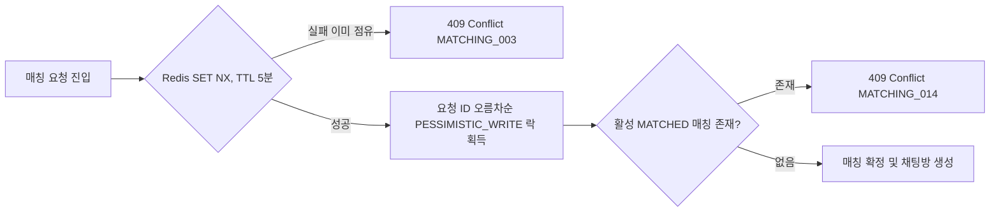

# 마주한끼 (Maju-Hankki) — 식사 동반자 매칭 서비스

> 부트캠프 2차 프로젝트 (2인 팀) · 혼자 밥 먹기 싫은 순간, 근처에서 같은 시간에 밥 먹을 사람을 실시간으로 매칭해주는 서비스

이 저장소는 팀 레포(fork)를 기반으로, 본인(sangmin)이 담당한 백엔드 개발 전반을 중심으로 정리한 포트폴리오용 README입니다. 실제 커밋 이력과 코드, docs/troubleshooting 문서를 근거로 작성했습니다.

## 프로젝트 소개

마주한끼는 사용자가 원하는 시간/장소/음식 선호를 입력하면, 비슷한 조건의 상대를 실시간으로 탐색해 매칭하고, 매칭이 성사되면 1:1 채팅방을 열어주는 식사 동반자 매칭 서비스입니다. 단순히 거리/시간만 맞추는 것이 아니라, 사용자가 작성한 식사 성향 텍스트를 임베딩으로 변환해 성향 호환도까지 점수화하는 것이 핵심 차별점입니다.

## 담당 역할 (sangmin — 백엔드 개발 전반)

- Spring Security + JWT 기반 인증/인가 구조 설계 및 구현
- Google OAuth2 소셜 로그인 연동
- WebSocket/STOMP 기반 실시간 1:1 채팅
- 카카오맵(Kakao Maps) 연동 선호 지역 등록 및 지도 표시, 행정동 좌표 검증
- 실시간 매칭 도메인 설계 (Redis 대기열, PostGIS 거리 필터, 비관적 락 기반 동시성 제어)
- pgvector 기반 단어 단위 임베딩 교차 비교로 매칭 호환도 점수 산출 로직 고도화
- 트러블슈팅: Refresh Token 쿠키 중복 발급 이슈, 실시간 매칭 동시성 이슈 해결

## 기술 스택


## 핵심 구현 내용

### 1. Spring Security + JWT 인증 구조

- JwtProvider가 사용자 UUID와 역할(UserRole)을 클레임에 담아 HS256으로 서명한 Access Token을 발급하고, 발급 시 issuer/audience를 함께 검증(requireIssuer, requireAudience)하도록 구성했습니다.
- JwtFilter가 매 요청의 토큰을 검증해 SecurityContext에 인증 정보를 세팅하며, Refresh Token은 DB(RefreshTokenRepository)에 해시로 저장(RefreshTokenHasher)하고 OpaqueTokenGenerator로 발급해 Access Token과 분리 관리합니다.
- Refresh Token Rotation(RTR) 방식으로 재발급 시마다 토큰을 교체하고, 재사용이 감지되면(RefreshTokenReuseDetectedException) 해당 세션 계열을 폐기하도록 설계했습니다.
- 비밀번호는 DelegatingPasswordEncoder로 bcrypt/argon2를 선택적으로 적용하고, CSRF는 CookieCsrfTokenRepository + SpaCsrfTokenRequestHandler로 SPA 프론트엔드에 맞게 처리했습니다.

### 2. Google OAuth2 소셜 로그인

- GoogleOAuthUserService에서 Google이 내려준 사용자 식별자(providerId)/이메일로 기존 회원을 조회하고, 없으면 신규 가입을 처리합니다.
- 동일 이메일로 다른 로그인 방식(LOCAL/KAKAO 등)이 이미 가입돼 있으면 가입을 막아 계정 중복을 방지하고(AUTH_005), 닉네임이 비어있거나 중복되면 임시닉네임 형태(예: 사용자_xxxxxxxx)로 안전하게 생성합니다.
- 탈퇴 등으로 비활성화된 계정은 로그인 시점에 차단합니다(AUTH_001).

### 3. WebSocket/STOMP 기반 실시간 채팅

- WebSocketConfig에서 /ws-chat STOMP 엔드포인트를 등록하고, WebSocketHandshakeInterceptor로 핸드셰이크 단계에서 쿠키 기반 JWT 인증을 수행합니다.
- ChatSubscriptionInterceptor(인바운드)와 ChatOutboundAccessInterceptor(아웃바운드)로 CONNECT/SUBSCRIBE/SEND 시점마다 채팅방 접근 권한을 검증하고, 메시지 사이즈(16KB)/전송 버퍼/전송 타임아웃을 제한해 악용을 방지했습니다.
- ChatMessageRateLimiter로 메시지 전송 속도를 제한하고, 채팅 메시지/채팅방은 각각 ChatMessage, ChatRoom 엔티티로 영속화됩니다.

### 4. 카카오맵 기반 선호 지역 등록/표시

- 프론트엔드(frontend/src/pages/match-map.js)에서 카카오맵으로 선호 지역을 지도에 표시/선택하고, 백엔드 KakaoRegionPinValidator가 카카오 로컬 API(/v2/local/geo/coord2regioncode.json)로 사용자가 찍은 좌표가 실제로 해당 행정동(H) 혹은 법정동(B) 코드 안에 있는지 서버 측에서 재검증합니다.
- 카카오 API 키가 설정되지 않았거나 호출에 실패하는 경우 UNAVAILABLE 결과로 품질 저하 없이 우회하도록 예외 처리했습니다.

### 5. pgvector 임베딩 기반 매칭 호환도 점수 계산

가장 공을 들인 부분입니다. 단순 태그 매칭만으로는 어떤 음식을, 어떤 분위기로 먹고 싶은지처럼 사용자가 자유 텍스트로 적는 미묘한 취향 차이를 반영할 수 없어서, 텍스트 임베딩 기반 의미 유사도를 도입했습니다.

- 데이터 모델 (1NF 정규화): 처음에는 사용자 1명당 임베딩 1개를 저장했지만, 희망 키워드를 단어 단위로 쪼개 비교하는 구조로 바꾸면서 UserPersonalityEmbedding 엔티티를 1사용자-N단어(원자 레코드) 구조로 리팩터링했습니다. PK를 BIGINT id로 전환하고, 단어 1개당 1536차원 벡터 1개를 독립 레코드로 저장합니다.

```java
@JdbcTypeCode(SqlTypes.VECTOR)
@Column(nullable = false, columnDefinition = "vector(1536)")
private float[] embedding;
```

  Hibernate의 hibernate-vector 모듈로 float[]를 PostgreSQL vector(1536) 컬럼에 직접 바인딩했고, 임베딩은 Spring AI(spring-ai-starter-model-google-genai-embedding)로 생성합니다.

- N x M 전수 교차 비교 (PersonalityCompatibilityCalculator.calculateFullMatrixCrossScore): 신청자의 희망 키워드 단어들과 후보자의 등록 키워드 단어들을 전부 교차시켜(N x M) 각 신청자 단어마다 가장 유사한 후보 단어의 점수를 구하고, 그 평균을 임베딩 점수로 사용합니다. 단어 하나하나를 비교하므로 단어 단위 뉘앙스 차이가 점수에 반영됩니다.
- 코사인 유사도 3단계 스케일링: 단순 코사인 유사도(-1~1)를 그대로 쓰면 실제 임베딩 공간에서 유사도 값이 좁은 범위(대략 0~0.5)에 몰려 점수 변별력이 떨어지는 문제가 있어, 구간별로 다른 기울기를 적용하는 3단계 스케일링을 직접 설계했습니다.

| 코사인 유사도 구간 | 점수 구간 | 의미 |
|---|---|---|
| 0 ~ 0.20 | 0 ~ 30점 | 거의 무관한 단어 |
| 0.20 ~ 0.50 | 30 ~ 70점 | 느슨하게 관련 |
| 0.50 ~ 1.0 | 70 ~ 100점 | 의미적으로 가까운 단어 |

  일치하는 태그가 0개일 때 과거처럼 50점(중립)을 기본값으로 주던 방식을 버리고 0점으로 명확히 계산하도록 바꿔, 매칭 안 되는 사람에게 애매한 고점수가 나가는 문제를 없앴습니다.
- 최종 호환도 = 고정 태그 80% + 임베딩 20%: 사용자가 직접 고른 확정 태그(PersonalityTag) 일치도를 주요 신호(80%)로 쓰고, 자유 텍스트 임베딩 유사도를 보조 신호(20%)로 가중 평균합니다. 둘 중 하나만 계산 가능해도(예: 한쪽에 자유 텍스트가 없음) 있는 신호만으로 점수를 산출합니다.
- 양방향 개별 점수(myScore): 초기에는 두 사용자 점수 중 낮은 쪽(pairScore)을 대표값으로 썼지만, 내가 상대를 얼마나 원하는지와 상대가 나를 얼마나 원하는지는 비대칭적일 수 있어 각 사용자 관점의 점수를 독립적으로 계산해 개별 전달하도록 리팩터링했습니다.
- 매칭 후보 탐색 자체는 BidirectionalCandidateSearchService에서 PostGIS 공간 쿼리로 반경 내 후보를 1차로 좁히고(식사 시간차 30분 이내, 상호 검색 반경 충족), 이후 양방향 하드필터를 통과한 후보에 대해서만 위 성향 호환도 계산을 수행해 불필요한 연산을 줄였습니다.

## 트러블슈팅

### 1. Refresh Token 쿠키 중복 발급 및 세션 꼬임

증상: 로그인/토큰 재발급 시 브라우저에 동일한 이름(refreshToken)의 쿠키가 2개 생성되어, 요청마다 두 값이 함께 전송되고 토큰 회전(RTR) 과정에서 어떤 쿠키가 유효한지 불명확해져 정상 세션이 강제 폐기되거나 401이 반복 발생.

원인: 서비스 초기 Refresh Token 쿠키 경로가 Path=/auth였다가 인증 구조 개선 과정에서 Path=/로 바뀌었는데, 브라우저는 쿠키를 이름 + 경로 조합으로 식별하므로 새 쿠키가 기존 쿠키를 덮어쓰지 않고 공존했습니다. 이후 /auth 하위 요청 시 두 경로 모두 매칭되어 쿠키 2개가 동시에 전송됐습니다.

해결:
- AuthCookieUtil.deleteLegacyRefreshTokenCookie()를 추가해 토큰 발급/재발급/로그아웃 시 Path=/auth, Max-Age=0 쿠키를 함께 내려 구버전 쿠키를 명시적으로 만료시킴.
- AuthController에서 요청에 담긴 모든 refreshToken 쿠키를 스트림으로 수집 후 distinct()로 중복 제거하여, 레거시로 남아있던 DB상의 세션까지 안전하게 일괄 폐기하도록 처리.

### 2. 실시간 매칭 중복 요청 및 동시성 이슈

증상: 매칭 요청 버튼 연타나 다중 탭/디바이스 동시 요청 시 중복 대기 요청이 생성되고, 심한 경우 한 사용자가 동시에 2개 이상의 MATCHED 매칭/채팅방에 매핑되는 데이터 정합성 붕괴가 발생.

원인:
- 기존 검사 로직이 WAITING 상태 요청 존재 여부를 단순 SELECT로만 확인해, 두 요청이 거의 동시에 들어오면 둘 다 기존 요청 없음으로 판정되어 중복 저장됨.
- Redis 기반 지리 대기열 탐색과 PostgreSQL 제안/매칭 저장 사이의 비동기 시차로, 두 후보가 동일 유저를 동시에 상호 수락하면 원자적 잠금 없이 Match와 ChatRoom이 중복 생성될 수 있었음.

해결:



- Redis 분산 락: 매칭 요청/제안 수락 진입 시 match:user:{userId} 키를 SET NX(TTL 5분)로 원자적 예약해 동일 사용자의 중복 진입을 차단.
- DB 비관적 락: 상호 수락 확정 트랜잭션에서 두 MatchRequest의 ID를 오름차순으로 정렬해 PESSIMISTIC_WRITE 락을 걸어, 교착 상태 없이 경쟁 상황에서 한쪽만 성공하도록 처리.
- 사용자당 활성 매칭 1개 정책: 새 요청 생성 전 Match.status = MATCHED인 활성 매칭 존재 여부를 선조회해 중복 매칭 자체를 서비스/DB 레벨에서 차단.

## 모니터링

monitoring/ 아래 Prometheus + Grafana 구성이 포함되어 있고, 대시보드(project2-overview.json)에는 HTTP 요청량/응답시간, JVM 메모리, HikariCP 커넥션 수, CPU 사용률 외에 매칭 후보 제안 처리량, 매칭 처리 시간(p95), 선택 기간 최종 매칭 완료 수 등 매칭 도메인 전용 지표 패널을 포함해 서비스 핵심 지표를 직접 추적할 수 있도록 구성했습니다.

## 실행 방법

```bash
# 1. 인프라 (Redis / Prometheus / Grafana) 기동
docker compose up -d

# 2. 백엔드 (Spring Boot)
./gradlew bootRun

# 3. 프론트엔드
cd frontend
npm install
npm run dev
```

PostgreSQL은 pgvector, PostGIS(hibernate-spatial) 확장이 활성화되어 있어야 하며, Google OAuth2 / Kakao REST API 키 등은 환경 변수 또는 application.yml 설정이 필요합니다.
